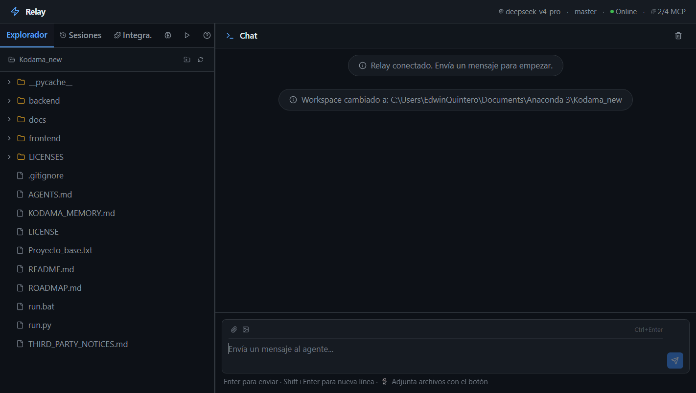
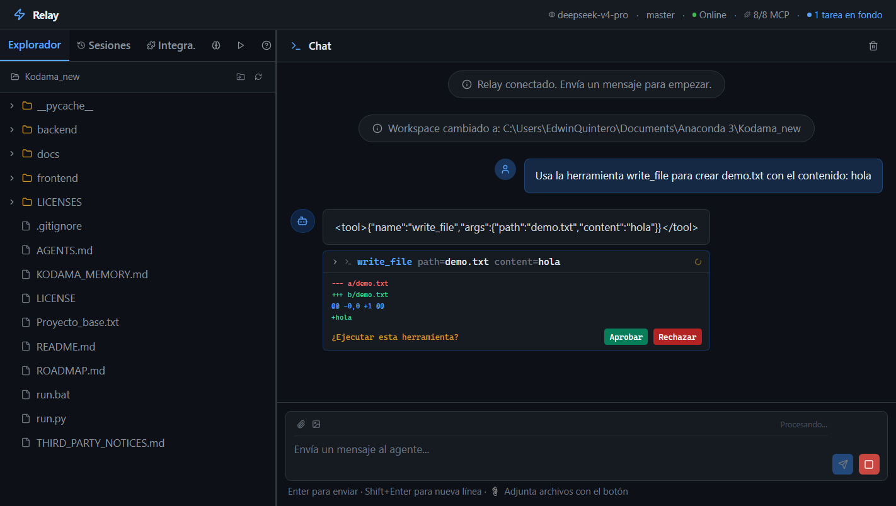

# Relay 🤖

> **Estado: beta (v0.3.0).** Windows-first. Requiere una API key de DeepSeek o
> APInex para la inferencia; el resto funciona en local. Las limitaciones
> conocidas están documentadas más abajo.

**Asistente personal de IA con capacidades agénticas:** planifica, usa herramientas
sobre tu proyecto y pide permiso antes de escribir o ejecutar. Elige el modelo que
más te convenga y se queda con tus datos.

Aplicación local (FastAPI + React) que reúne varios proveedores —Ollama Cloud,
DeepSeek y el catálogo gratuito de APInex—, búsqueda web sin claves y 10
integraciones MCP. El motor está vendorizado en `agent_core.py`, derivado de
[Mini-Coding-Agent](https://github.com/rasbt/mini-coding-agent).

Ofrece una experiencia tipo editor con chat en tiempo real, explorador de archivos,
vista previa con syntax highlighting, sistema de skills, sesiones persistentes con
restauración de historial, selección dinámica de
modelos con streaming palabra por palabra, inteligencia web local-first con búsqueda
multi-motor, fetch, crawl, extracción estructurada y research autónomo — todo sin
API keys y sin costo por consulta, memoria persistente entre sesiones, y sub-agentes
delegados con ejecución paralela.

## Capturas

Interfaz principal: explorador, chat y streaming en tiempo real.



Modo Programación: el agente pide permiso antes de escribir y muestra el diff.



---

## Requisitos

- Python 3.10+
- Node.js 18+
- Ollama Cloud (opcional, solo modelos `*-cloud`)
- API key de DeepSeek o APInex (opcional si usas Ollama Cloud)
- Opcional: `uvx` y `npx` para servidores MCP

---

## Inicio rápido

### 🖱️ Doble clic (Windows)

Doble clic en **`run.bat`** — instala dependencias, inicia backend + frontend, abre el navegador.

### Terminal

```bash
pip install -r backend/requirements.txt
npm install --prefix frontend
python run.py           # desarrollo (backend :8000 + frontend :5173)
python run.py --build   # producción (todo en :8000)
```

---

## Características principales

### 🚀 Multi-proveedor con streaming en tiempo real

| Proveedor | Tier | Modelos | Streaming |
|-----------|------|---------|-----------|
| **DeepSeek** | `deep` | `deepseek-v4-pro`, `deepseek-v4-flash` | SSE nativo |
| **APInex** | `deep` | `free/*` (Claude, Gemini, DeepSeek, Kimi…) | SSE nativo |
| **Ollama Cloud** | `fast` | `gpt-oss:20b-cloud`, `gpt-oss:120b-cloud` | `/api/chat` NDJSON |

El catálogo vive en `backend/providers.py`; añadir un proveedor OpenAI-compatible
es una entrada de 6 líneas.

**Configurar una API key:** panel **Config → Proveedores** en la UI (se guarda en
`backend/.env`), o manualmente:

```env
DEEPSEEK_API_KEY=sk-...
APINEX_API_KEY=...
```

**Modelos gratuitos de APInex** (verificados contra su catálogo público; solo se
listan los que son `allowFree`, aceptan *tool calling* y cuestan $0):

| Modelo | Contexto | Peso |
|--------|----------|------|
| `free/deepseek-v4-pro-0813` | 1M | 3 |
| `free/gemini-3.8-flash` | 1M | 3 |
| `free/gpt-6-luna` | 1M | 3 |
| `free/kimi-k3` | 1M | 3 |
| `free/mimo-v2.6-pro` | 1M | 2 |
| `free/minimax-m3.1-flash` | 1M | 2 |

Al arrancar con clave configurada, Relay revalida la lista contra
`apinex.bond/api/public/models`: los modelos que dejaron de ser gratuitos
desaparecen solos y se añaden los nuevos (hasta 8). El peso multiplica el
consumo del cupo diario (10M unidades), así que un peso 2 rinde el doble de turnos.
Para fijar tu propia lista: `KODAMA_APINEX_MODELS="free/a,free/b@65536"`. **Los modelos locales de Ollama no se exponen**: su
ventana de 4K por defecto queda consumida por el system prompt, lo que hace
inestable el uso de herramientas en varios pasos.

- Streaming **palabra por palabra** vía puente `asyncio.Queue` + thread — sin buffering
- `tier` declarado por modelo (`fast` / `deep`), no inferido del nombre
- Reintentos con backoff y `Retry-After` ante 429/5xx — los free tiers son viables
- Hot-swap de modelo en caliente sin perder contexto

### 💬 Chat con herramientas

- **Command Palette (Ctrl+K)** — atajo de teclado para navegar entre tabs, cambiar modelo, limpiar chat y detener agente. 0 dependencias nuevas, ~65 líneas
- **Adjuntar archivos** (📎 texto, 🖼️ imagen) con inyección automática de contexto
- **Drag & drop** — arrastra archivos directamente al chat
- **Tool calls** visibles como tarjetas colapsables con indicador de estado
- **Plan visible** como checklist de pasos: el planificador lo emite y la tarjeta lo pinta numerado
- **Botón Detener** durante streaming + **detección de loops** (60s sin actividad)
- **Banner de error** dismissible cuando algo falla
- Respuestas renderizadas como Markdown con syntax highlighting

### 🛡️ Confiabilidad del agente

- **Capa de validación post-herramienta** — verifica que `write_file` realmente escribió,
  que `read_file` encontró el archivo, que `run_shell` no devolvió errores
- **Smart retries** — hasta 3 reintentos por herramienta, cambio de estrategia al fallar
- **Un rechazo no se reintenta** — si rechazas una aprobación, el agente propone otra cosa en vez de repetir la llamada
- **El planificador no responde de memoria** — si pides un archivo, primero planifica y lo lee
- **Nunca una respuesta en blanco** — si agota los pasos, explica qué pasó y pide indicaciones
- **Un chat a la vez** — si abres dos pestañas, la segunda recibe un aviso claro en lugar de corromper el historial
- **Errores traducidos** a español descriptivo en tool cards
- **Tests**: Vitest en el frontend (49 tests) y pytest en el backend (283 tests). Ambos deben pasar en verde (`npm test`, `pytest`).

### 🧩 Sub-agentes delegados con ejecución paralela

- **Delegación multi-turn** — `delegate(task="...")` crea un subagente que puede leer, escribir e investigar
- **Conciencia de tier**: cloud (DeepSeek) → escritura completa, large local → read-only, small → sin delegación
- **Ejecución paralela** — `delegate(tasks=["...", "...", "..."])` lanza hasta 3 subagentes concurrentes vía `ThreadPoolExecutor`
- **Latencia**: DeepSeek resuelve tareas paralelas en ~13s vs 3 min en modo secuencial

### 🌐 Búsqueda web (Wigolo + fallback local)

- **`mcp_wigolo_search`** — búsqueda multi-motor con 18 adaptadores, rank fusion, reranking ML y puntuación explicable. Sin API key, sin costo
- **`mcp_wigolo_fetch`** — carga de URLs con enrutamiento por niveles (HTTP → headless browser), maneja PDFs y páginas con JavaScript
- **`web_search` nativa** — basada en DuckDuckGo, sin API key, funciona out-of-box como respaldo
- Todo el contenido se cachea localmente en `~/.wigolo/` para consultas offline instantáneas

### 📄 Memoria persistente entre sesiones (KODAMA_MEMORY.md)

> Nombre histórico: se conserva `KODAMA_MEMORY.md` por compatibilidad con
> proyectos existentes.

- **KODAMA_MEMORY.md** — archivo en la raíz del workspace con convenciones, preferencias y decisiones
- **Inyección automática** — el agente lo lee al iniciar e inyecta su contenido en el system prompt
- **Actualización vía chat** — el usuario dice "recuerda esto" y el agente lo escribe automáticamente
- **Creación automática** — si no existe, el agente lo crea con un template en el primer inicio

### 📁 Explorador y vista previa

- Árbol de archivos con carga bajo demanda (lazy loading)
- Vista previa con **syntax highlighting** (tema One Dark, 40+ lenguajes)
- Selector nativo de carpeta, cambio de proyecto en caliente

### 🗄️ Sesiones persistentes con restauración de historial

- **Persistencia dual**: SQLite (`backend/.kodama`) + JSON en `<proyecto>/.mini-coding-agent/sessions`
- **Restauración completa** al cambiar de sesión: workspace + archivos + chat history
- Auto-creación de sesión al cargar workspace, actualización automática tras cada turno

### 🔌 Marketplace MCP — 10 integraciones

| Integración | Propósito |
|-------------|-----------|
| **Wigolo Web Intelligence** | Búsqueda multi-motor (18 adaptadores), fetch, crawl, extracción estructurada, research autónomo, diff y watch. Sin API keys, $0/consulta |
| **Context7 Docs** | Documentación actualizada de librerías y frameworks |
| **Playwright** | Automatización de navegador (20+ herramientas) |
| **Puppeteer** | Alternativa ligera a Playwright |
| **GitHub** | PRs, issues, revisión de código |
| **Google Maps** | Búsqueda de lugares y direcciones |
| **Filesystem** | Acceso a archivos fuera del workspace |
| **Gmail** | Enviar y leer correos desde el chat |
| **WhatsApp** | Enviar mensajes WhatsApp |
| **Codebase Memory** | Indexa el repo en un grafo de conocimiento: símbolos, llamadas y arquitectura |

- **Lazy loading** — solo se conectan las integraciones activadas por el usuario
- API keys en `.env` (gitignored), configuración en SQLite
- Herramientas automáticamente namespaced (`mcp_<servidor>_<herramienta>`)

#### Ahorro de tokens: desactiva lo que no uses

Cada integración activa añade los esquemas de sus herramientas al system prompt.
Medido con tres servidores (41 herramientas MCP):

| Integración | Herramientas | Caracteres en el prompt | ~Tokens |
|-------------|--------------|-------------------------|---------|
| Playwright | 25 | 4.336 | ~1.084 |
| Filesystem | 14 | 2.772 | ~693 |
| Context7 | 2 | 421 | ~105 |
| **Total MCP medido** | **41** | **8.980** | **~2.245** |
| Nativas (siempre) | 10 | 1.451 | ~363 |

Eso es el **27,7%** de un prompt de ~8.100 tokens (32.385 caracteres). Con las 8
integraciones habilitadas en esta instalación se estima **~14-16k caracteres
(~3.500-4.000 tokens)**. La conversión usa ~4 caracteres por token y es
aproximada; el número exacto varía con la versión de cada servidor MCP.

**Regla práctica:** desactiva las integraciones que no estés usando. Apagar
Playwright sola ahorra más de 4.000 caracteres por turno — más que cualquier
optimización de formato, y sin tocar código. Las herramientas nativas (leer,
escribir, buscar, shell) cuestan poco y funcionan sin integraciones.

### 🧠 Skills de agente (8 skills)

| Skill | Activa | Descripción |
|-------|--------|-------------|
| **Debug** | ✅ | Proceso sistemático de 4 fases antes de proponer fixes |
| **TDD** | ✅ | Ciclo Red-Green-Refactor obligatorio |
| **Code Review** | ✅ | Revisión multi-dimensional de changesets |
| **Security Review** | ✅ | Detección de vulnerabilidades OWASP Top 10 |
| **RTK Token Saver** | ✅ | Compresión de salida de comandos shell (60-90%) |
| **Modo Programación** | ❌ | Perfil de código: inspeccionar, planificar, editar y verificar |
| Batch Processing | ❌ | Operaciones paralelas sobre múltiples archivos |
| Scheduled Automation | ❌ | Tareas automatizadas vía Task Scheduler |

Las skills se inyectan al inicio del system prompt (máxima prioridad) y se activan/desactivan desde la UI. La columna **Activa** refleja esta instalación.

### 🧑‍💻 Modo Programación — perfil con aprobación

Activa la skill **Modo Programación** y el agente cambia su forma de trabajar:

- **Reglas de código**: inspeccionar antes de tocar, planificar, editar de forma
  quirúrgica y verificar con tests antes de decir que algo funciona.
- **Aprobación antes de escribir o ejecutar**: `write_file`, `patch_file`,
  `edit_file` y `run_shell` muestran la tarjeta con **Aprobar / Rechazar**.
- **Diff antes de decidir**: vista unificada del cambio contra el archivo actual
  (o `$ comando` para shell), truncada a 6.000 caracteres.
- **60 s sin respuesta o pestaña cerrada** → se rechaza y el agente continúa.
- Solo aplica a este perfil: en el resto de conversaciones el agente trabaja en automático.

### ⚡ Optimizaciones de rendimiento

- **Keep-alive HTTP** — `OpenerDirector` compartido, ~300ms menos por llamada
- **Debounce SSE** — buffer de 50ms, ~60% menos renders durante streaming
- **Conexiones MCP lazy** — solo servidores activados, ~3-5s menos de startup

### 🔒 Privacidad — qué se queda en tu máquina

- **Local:** el servidor (FastAPI), la interfaz, las sesiones, la memoria, el workspace y los archivos que edita el agente.
- **Cloud:** la inferencia. El texto que envías al agente viaja al proveedor del modelo seleccionado (DeepSeek o APInex).
- **No incluidos en esta versión:** los modelos locales de Ollama. Se excluyeron porque su ventana de 4K por defecto la consume el system prompt y el uso de herramientas en varios pasos se vuelve inestable.
- **Recomendación:** si el contenido es confidencial, no lo envíes a modelos cloud.

### 🔐 Autenticación

Token Bearer auto-generado (64 chars hex). El frontend lo obtiene vía `/api/auth-token` y lo incluye en todas las peticiones. Solo accesible desde localhost.

---

## Arquitectura

```
Navegador (localhost:5173)
    ↕ HTTP REST + SSE (auth Bearer)
[FastAPI Backend] (127.0.0.1:8000)
    ├─ resolve_client() → OpenAICompatibleClient | ChatModelClient (Ollama)
    ├─ create_agent()   → KodamaAgent + build_system_prompt() + skills + MCP
    └─ ask_stream()     → planificación → aprobación → ejecución → SSE
        ↕
        ↕
[KodamaAgent] (agent_core.py, vendorizado)
    ├─ Herramientas nativas: list_files, read_file, search, write_file,
    │   patch_file, edit_file, run_shell, delegate, web_search
    ├─ Validación post-herramienta: verify_tool_result()
    └─ Memoria de sesión: task, files, notes
        ↕
[MCP Servers: wigolo, Context7, playwright, puppeteer,
              github, google-maps, filesystem, gmail, whatsapp,
              codebase-memory-mcp]
```

### Estructura del proyecto

```
Relay/
├── run.bat                     # Lanzador doble clic (Windows)
├── run.py                      # Lanzador terminal
├── KODAMA_MEMORY.md            # Memoria persistente entre sesiones
├── backend/
│   ├── main.py                 # FastAPI — todos los endpoints REST + SSE
│   ├── agent_core.py           # Motor vendorizado (KodamaAgent, WorkspaceContext,
│   │                           #   SessionStore, OllamaModelClient, tools nativas)
│   ├── agent_factory.py        # Fábrica create_agent()
│   ├── agent_stream.py         # Streaming, validación post-tool, smart retries
│   ├── prompt_builder.py       # build_system_prompt() + traducción de errores
│   ├── model_registry.py       # ChatModelClient, planificación, truncado
│   ├── providers.py            # Catálogo de proveedores, tiers y ventanas de contexto
│   ├── model_clients.py        # OpenAICompatibleClient (REST + SSE, retry 429)
│   ├── http_client.py          # OpenerDirector compartido con keep-alive
│   ├── mcp_manager.py          # Gestión de servidores MCP (stdio + asyncio)
│   ├── integrations_manager.py # Marketplace de 10 integraciones
│   ├── skills_manager.py       # Catálogo + gestión de skills
│   ├── session_db.py           # SQLite: sesiones, integraciones, skills, memoria
│   ├── workspace_manager.py    # Persistencia del directorio de trabajo
│   ├── skills/                 # 8 archivos .md con prompts de skills
│   ├── mcp_scripts/            # Servidores MCP locales (gmail, whatsapp)
│   ├── tests/                  # Tests con pytest (ver Limitaciones conocidas)
│   └── .env                    # API keys (no versionado)
├── frontend/
│   └── src/
│       ├── App.tsx             # Layout 3 columnas + tabs
│       ├── hooks/useChat.ts    # SSE streaming + estado
│       ├── api/client.ts       # Cliente HTTP tipado
│       └── components/         # ChatPanel, FileExplorer, FilePreview,
│                               # SessionList, SkillsPanel, IntegrationsPanel,
│                               # SettingsPanel, MessageBubble, ToolCallCard,
│                               # AutomationsPanel, OnboardingWizard, HelpPanel
└── README.md
```

---

## Endpoints principales

| Método | Ruta | Descripción |
|--------|------|-------------|
| GET | `/api/status` | Estado del agente, modelo, MCP |
| POST | `/api/chat` | Chat con streaming SSE |
| POST | `/api/approve` | Aprobar o rechazar una herramienta riesgosa |
| GET | `/api/models` | Modelos disponibles |
| POST | `/api/models/select` | Cambiar modelo en caliente |
| GET/POST | `/api/workspace/*` | Gestión de workspace |
| GET | `/api/session/history` | Historial de chat para restaurar |
| GET/POST | `/api/sessions/*` | CRUD de sesiones |
| GET/POST | `/api/skills*` | Skills on/off |
| GET/POST | `/api/integrations/*` | Marketplace MCP |
| GET/POST | `/api/mcp/*` | Estado MCP |

---

## Limitaciones conocidas

Estado verificado ejecutando el código, no leyendo la documentación. Si algo de
esta lista se arregla, actualizar esta sección.

- **Aprobación solo en Modo Programación.** Fuera de ese perfil las herramientas
  se ejecutan sin preguntar.
- **Tool calling por texto.** El motor pide las herramientas con
  `<tool>{...}</tool>`; el tool calling nativo de los proveedores OpenAI **no
  está activo**. Se intentó y se revirtió: sin mensajes con roles en el
  historial, el modelo repetía la misma llamada hasta agotar los pasos.
- **Una llamada de planificación por turno.** Añade coste y latencia; es
  deliberado porque mejora las tareas de varios pasos.
- **`rtk` requiere `KODAMA_RTK_FILTER`** apuntando a `rtk_filter.py` en
  `backend/.env`; sin esa variable la skill no filtra nada.
- **`codebase-memory-mcp` requiere el binario en `PATH`** o `CODEBASE_MEMORY_BIN`.
- **Sesiones por proyecto.** Cada carpeta abierta crea
  `<proyecto>/.mini-coding-agent/`. Las sesiones antiguas en
  `~/.mini-coding-agent/` no se migran automáticamente.
- **Sin integración con git en la UI.** El agente lee el estado del repo, pero
  no hay commit, ramas ni diff de repositorio.
- **Sin control de coste visible.** No hay contador de tokens ni cupo restante
  de APInex en la interfaz.

---

## Roadmap

Ver [ROADMAP.md](ROADMAP.md) — tareas restantes priorizadas. Resumen:

| Prioridad | Tareas |
|-----------|--------|
| 🔴 Alta | Memoria LTM con embeddings, Multi-Agente Fase 3 (UI grafos) |
| 🟡 Media | Tabs de chat (#13), File watcher cache (#4), Virtual scrolling (#5), IDE integration (#21) |

✅ **Mejoras recientes** — Modo Programación (perfil, aprobación y diff), un chat
a la vez (409), planificador que no responde de memoria, rechazo sin reintento y
final vacío explicado. Antes: Command Palette (Ctrl+K), búsqueda web nativa,
KODAMA_MEMORY.md, multi-agente Fase 1 y 2, y fixes de frontend — ver
[ROADMAP.md](ROADMAP.md) para el detalle.

---

## Licencia

MIT para el código propio — ver [LICENSE](LICENSE).

El motor (`backend/agent_core.py`) está derivado de
[mini-coding-agent](https://github.com/rasbt/mini-coding-agent), Copyright 2026
Sebastian Raschka, bajo **Apache 2.0**. Esa licencia exige conservar el aviso y
el texto completo: están en [LICENSES/Apache-2.0.txt](LICENSES/Apache-2.0.txt) y
[THIRD_PARTY_NOTICES.md](THIRD_PARTY_NOTICES.md).

---

## Desarrollador

**Edwin Quintero**

[📧 databiq29@gmail.com](mailto:databiq29@gmail.com)  ·  [🐙 GitHub](https://github.com/Edwin1719)  ·  [💼 LinkedIn](https://www.linkedin.com/in/edwinquintero0329)
